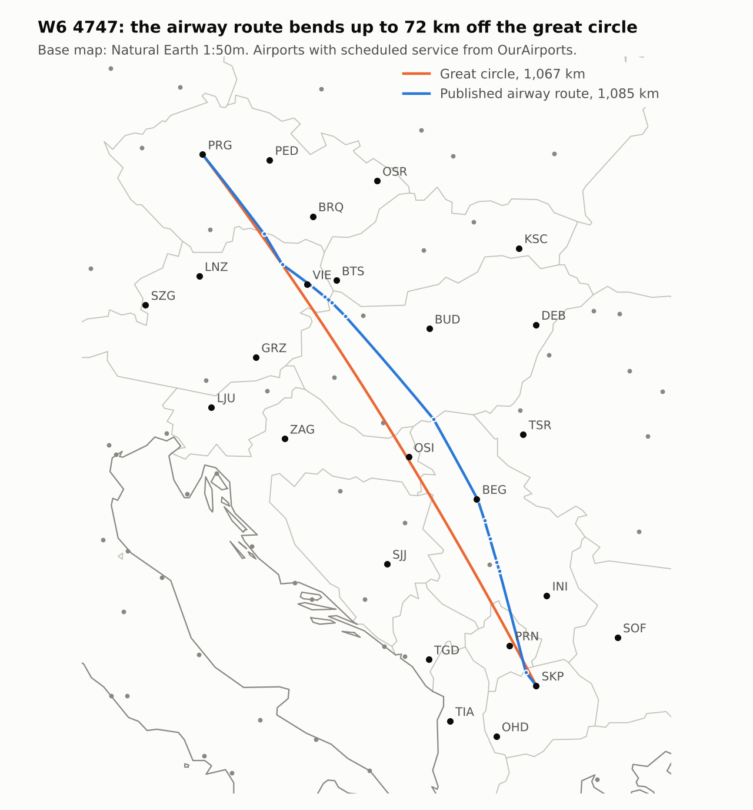
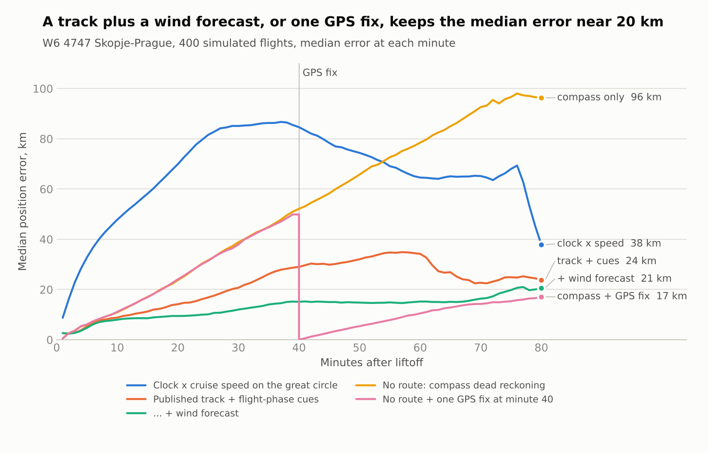

# Inflight Locator

An Android app that estimates where an airliner is from a phone deep inside the cabin, with no satellite signal, and shows the estimate as a dot inside an error circle that holds the true position about 95% of the time. It combines the clock, a preloaded reference track and wind forecast, flight phases read from cabin pressure and the accelerometer, the compass, the magnetic field, and any GPS fix that happens to arrive. **Not for navigation.**



## Status

- **Spec:** [docs/SPEC.md](docs/SPEC.md), with flight W6 4747 (Wizz Air, Skopje to Prague) as the worked example.
- **Engine:** pure Kotlin, verified on a laptop against the Python prototype and on synthetic sensor data: [engine/](engine), described in [docs/ALGORITHM.md](docs/ALGORITHM.md).
- **App:** built in Google AI Studio from the prompts in [prompts/](prompts). The app's code lives in AI Studio (export as ZIP); this repository keeps the engine it is built on.
- **Next milestone:** log real flights with GPS as truth and replace the design values with measured ones. Every accuracy figure below is a best case from simulation.

## Build the app

Follow [prompts/README.md](prompts/README.md): in AI Studio choose **Build**, platform **Android**, then paste the prompts in order. Each ends with a check you can run in the browser emulator; the app's Diagnostics screen runs the engine's 41 self-checks on the device.

## Accuracy in simulation



400 simulated W6 4747 flights, median error over the whole flight (90th percentile in brackets), Python prototype / Kotlin engine:

| What the app knows | Median error, km |
| --- | --- |
| Clock and cruise speed along the great circle (baseline) | 64.6 (118) / 64.6 (115) |
| Published track + flight-phase cues | 19.3 (55) / 18.9 (53) |
| ... + wind forecast | 12.7 (28) / 13.4 (28) |
| ... + one GPS fix at minute 40 | 10.5 (30) / 10.9 (30) |
| No route: compass dead reckoning | 48.1 (132) / 48.1 (143) |
| ... + magnetometer | 43.9 (112) / 42.6 (110) |

Driven by synthetic barometer and accelerometer streams instead of ideal cues, the known-route median moves from 20.5 to 20.8 km on the same 200 flights. Details and long-haul results: [docs/ALGORITHM.md](docs/ALGORITHM.md#8-validation).

## Repository

| Path | Contents |
| --- | --- |
| [docs/](docs) | spec, algorithm notes, figures |
| [engine/](engine) | the Kotlin engine, its tests (`engine/run.sh`) and results |
| [prompts/](prompts) | AI Studio prompts, in order |
| [prototype/](prototype) | the Python Monte Carlo prototype and its results |
| [data/](data) | airports, base map, the W6 4747 plan, magnetic model coefficients |
| [testvectors/](testvectors) | reference values from the prototype and pygeomag |
| [tools/](tools) | scripts that generate the data, figures and prompts |
| [AGENTS.md](AGENTS.md) | rules for changing the engine |

## Test the engine

With a JDK 17+ and `kotlinc` (or a Gradle distribution, whose bundled compiler is used):

```bash
engine/build.sh
engine/run.sh selftest
engine/run.sh mc --runs 400 --airports data/airports.csv --check
engine/run.sh pipeline --runs 200
```

## Data and credits

Airports from [OurAirports](https://ourairports.com/data/) (public domain), coastlines and borders from [Natural Earth](https://www.naturalearthdata.com/) (public domain), the [World Magnetic Model 2025](https://doi.org/10.25921/aqfd-sd83) from NOAA NCEI and the British Geological Survey, and wind forecasts in the app from [Open-Meteo](https://open-meteo.com/). Sources for the spec's figures are listed at its end. No licence has been chosen for this repository's own code yet.
