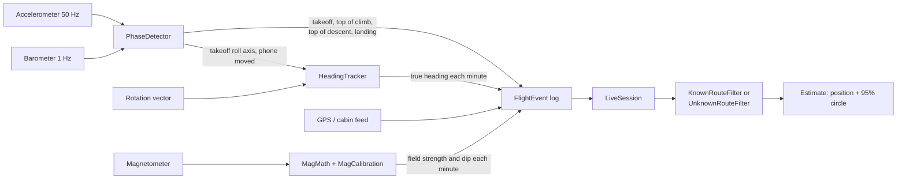

# How the engine works

This is the technical companion to [SPEC.md](SPEC.md). Every name in `code` is a class or function in [`engine/src/main/kotlin/inflight/engine`](../engine/src/main/kotlin/inflight/engine).

The app turns raw sensor samples into a handful of events per minute. `LiveSession` applies them, in the order they became known, to one of two particle filters and asks it for the estimate whenever the screen needs one.

## 1. Candidates and how they move

A filter carries 1,500 candidates (particles). Each is one complete guess about the flight:

| Per candidate | Meaning | Prior (design value) |
| --- | --- | --- |
| `wind` | along-track wind at cruise, km/h | N(0, 60), or N(forecast, 15) with a forecast |
| `wdev` | slow change of that wind along the route | Ornstein-Uhlenbeck, sd 14 km/h, length 127 km |
| `tas` | true airspeed, km/h | N(840, 12) for an A321neo |
| `tc` | liftoff to top of climb, s | N(18.5 min, 2 min), at least 12 min |
| `dtod` | track distance from top of descent to touchdown, km | N(225, 20) |
| magnetometer bias | field-strength and dip offsets | a small Kalman filter per candidate, see 3.3 |

Time advances in 30-second steps from liftoff. Ground speed follows a climb ramp, `v = vLo + (vCruise - vLo) * (1 - (1 - t/tc)^3)` with `vLo` = 300 km/h, then cruise at `tas + wind + wdev`, then a descent ramp from top of descent, `v = vApp + (vTod - vApp) * (1 - u^3)` where `u` is the share of the descent distance flown and `vApp` = 250 km/h.

**Known route** (`KnownRouteFilter`). The position is a distance `s` along a reference track plus a sideways offset: an en-route wander `c` (Ornstein-Uhlenbeck, sd 12 km around a preloaded track, or 4.2% of the distance around a great circle, correlation length 15% of the route, at least 150 km), a departure term (sd 7 km, fades over the first 40 km) and an arrival term (sd 18 km, active in the last 150 km). A candidate also carries `E`, the extra distance flown around the airports (shortcuts, downwind legs); its prior comes from simulating many arrivals (`FlightSim.extraKmPrior`). Inside the 150 km arrival zone each candidate moves along the reference more slowly by `zone / (zone + E)`, so it reaches the runway after flying the extra distance.

**Unknown route** (`UnknownRouteFilter`). The position is a latitude and longitude, starting within a few km of the origin, moved each step along the measured true heading minus a per-candidate heading bias (compass error plus the wind drift angle, sd about 6 degrees). When the heading source is lost the biases widen by 20 degrees and the candidates keep their last direction; a new alignment resets them.

## 2. Flight-phase cues

**Top of climb** at time `t`: each candidate is weighted by `exp(-0.5 * ((tc - t) / 60 s)^2)`.

**Top of descent** at time `t`: the candidate's remaining track distance at that moment should equal its own `dtod`. Weight `exp(-0.5 * ((remaining - dtod) / sigma)^2)` with sigma = 75 seconds of cruise (about 18 km). The detector reports the event about a minute late, so the filter adds the distance flown since the event before comparing, then starts every candidate's descent from that point.

**Silence counts.** Until the top-of-descent cue arrives, candidates that should already be descending lose weight in proportion to how far past their own top of descent they are. The penalty is replaced, not accumulated, at each step, and it allows for the detector's reporting delay (`cueLagS`, 100 s in the app). If no cue has come long after the latest plausible top of descent, the filter stops waiting (`todDeadlineS`) and lets each candidate descend on its own schedule. Phones without a barometer never expect cues.

## 3. Other observations

**3.1 GPS fix or cabin-feed position** (`onGpsFix`). First the cloud is reweighted by distance to the fix with a Gaussian of 8 km, widened by 1.5 times until at least 5% of the weight survives, so candidates with the right wind and heading bias are kept. After resampling, every candidate is moved onto the fix (known route: projected onto the track). With a ground speed and course from the same fix, cruise candidates take that speed and the heading biases take the measured drift. On a known route a fix more than 60 km (or four lateral standard deviations) off the track switches the session to an unknown-route filter started at the fix.

**3.2 Heading** (`setHeading`). Only the unknown-route filter uses it, as described above.

**3.3 Magnetic field strength and dip** (`onMagnetic`). Each candidate predicts field strength F and dip I from the World Magnetic Model at its position and altitude (`Wmm2025`, degree 12, geodetic to geocentric conversion, checked against NOAA's model in pygeomag to 0.01 nT). The phone's residual biases are not sampled: each candidate keeps the mean of a Kalman filter for its bias, with a shared variance that starts at (0.7 microtesla, 1.5 degrees) after gate calibration and grows as a random walk of (0.2, 0.4) per square root of 30 minutes. The candidate's weight is the innovation likelihood; one-minute averages carry noise of (0.3 microtesla, 0.5 degrees). This Rao-Blackwellised form avoids the particle depletion that sampled biases caused in the prototype.

**3.4 Particle hits** (`onCosmic`). Expected hits per window come from a cruise rate of 19.3 per hour (one published phone measurement) scaled by an assumed cutoff-rigidity curve (centred-dipole approximation) and altitude; the weight is the Poisson likelihood. In the simulations this input made no measurable difference.

## 4. Resampling and the estimate

When the effective sample size falls below half the candidates, systematic resampling copies the heavy candidates and adds small jitter (wind 2 km/h, airspeed 1 km/h, descent distance 2 km, extra distance 1 km, heading bias 0.2 degrees). The estimate is the weighted mean position on the sphere; the error radius `r95Km` is the distance from that mean that holds 95% of the weight. In the simulations the true position was inside that circle in 93 to 97% of flight-minutes in the Python prototype and 91 to 98% in the Kotlin engine.

## 5. Flight phases from sensors (`PhaseDetector`)

**Barometer.** Samples are averaged per second; the cabin-pressure trend is a straight-line fit over the last 60 seconds.

| Transition | Rule | Event time |
| --- | --- | --- |
| Ground to climb (takeoff) | trend below -3 hPa/min for 40 s and at least 4 hPa lost in 2 min | corner of a two-line fit over the last 5 min; the accelerometer's liftoff time instead when it is within 3 min |
| Climb to cruise (top of climb) | trend within plus or minus 0.8 hPa/min for 90 s, at least 5 min after takeoff | corner of a two-line fit |
| Cruise to descent (top of descent) | trend above +2.5 hPa/min for 45 s and at least 4 hPa gained in 2 min | corner of a two-line fit |
| Descent to landed | level for 90 s and at least 85% of the climb's pressure drop recovered (adjusted for the elevation difference) | corner of a two-line fit |

A climb that turns straight into a descent (a short flight) reports top of climb and top of descent together.

**Accelerometer.** Samples are averaged in 200 ms bins. A gravity reference is learned while the phone is still. The takeoff roll is a steady horizontal push of 1.2 to 5 m/s² holding its direction within 30 degrees for 20 s; liftoff is taken as 35 s after the push began, and the push direction becomes the nose axis. The landing roll is a push of the same size toward the tail for at least 8 s that ends within 90 s (a lasting push is an attitude change, not a landing). Without a barometer these two rolls are the only phase events. Handling is jitter above 1 m/s² for 1 s, or in barometric cruise a tilt of more than 10 degrees for 3 s; once the phone has been still for 5 seconds, a gravity direction changed by more than 4 degrees means it moved, and the nose axis is dropped.

After an app restart mid-flight, `resumeAirborne()` puts the detector back into the logged phase.

## 6. Heading (`HeadingTracker`)

The app gives the rotation matrix from Android's rotation-vector sensor (device to east-north-up, magnetic north). The aircraft's heading is the compass direction of the nose axis plus the magnetic declination from the model, plus an offset. After the takeoff roll, the offset is the difference between the nearest runway direction of the origin airport and the measured roll direction, which removes the compass error at that moment; manual alignment (phone flat, top edge toward the cockpit) uses no offset. The heading is valid until the phone moves.

## 7. Session, log and replay (`LiveSession`)

A flight is a `FlightPlan` (origin, destination, optional route points and wind forecast, decimal year, airspeed and cruise altitude) plus a list of `FlightEvent`s: takeoff, top of climb, top of descent, heading, heading lost, magnetic reading, particle hits, GPS fix and landing. Each event carries the time it became known and, for phase events, the time it happened. The session processes the logged (text) form of every event and runs from a fixed seed, so `LiveSession.fromLog()` rebuilds exactly the same state after an app restart; the self-test checks this. Before takeoff the estimate is the origin airport; after landing it is the airport chosen by `LandingSnap` (distance from the estimate and alignment of a runway with the landing heading; the planned destination wins whenever it is consistent with the estimate).

`Evaluation.compare()` matches logged estimates with a timed track of the real flight (KML, GPX or flight-tracker CSV) and returns the median and 90th-percentile error and the share of estimates whose circle held the truth: the acceptance tests of the spec.

## 8. Validation

**The Kotlin engine against the Python prototype.** Same experiment, 400 simulated W6 4747 flights each, different random numbers. `engine/run.sh mc --runs 400 --check` fails if any estimator's median, 90th percentile, last-five-minutes median or circle coverage leaves the tolerance.

| Estimator | Python median / p90, km | Kotlin median / p90, km | Kotlin coverage |
| --- | --- | --- | --- |
| Clock x cruise speed on the great circle | 64.6 / 117.7 | 64.6 / 114.6 | none |
| Great circle + phase cues | 41.7 / 79.3 | 41.1 / 79.3 | 97.7% |
| Published track + phase cues | 19.3 / 55.0 | 18.9 / 52.8 | 94.7% |
| ... + magnetometer | 18.3 / 50.5 | 18.5 / 49.5 | 94.7% |
| ... + wind forecast | 12.7 / 28.0 | 13.4 / 28.3 | 95.8% |
| ... + GPS fix at minute 40 | 10.5 / 29.9 | 10.9 / 30.2 | 95.3% |
| Unknown route, compass | 48.1 / 132.4 | 48.1 / 142.8 | 92.5% |
| ... + magnetometer | 43.9 / 112.5 | 42.6 / 110.1 | 93.1% |
| ... + GPS fix at minute 40 | 13.2 / 45.0 | 14.0 / 47.5 | 90.8% |

Without a route, the landing match picked Prague in 78% of flights with the runway heading (Python 80%), and in every flight after a mid-flight GPS fix (97% on position alone). Full output: [engine/results](../engine/results) and [prototype/results](../prototype/results).

**The whole pipeline on synthetic sensor data.** `engine/run.sh pipeline` generates cabin pressure and accelerometer streams for 200 simulated flights (phone at a random orientation, taxi manoeuvres, takeoff roll, climb attitude, turbulence, landing roll), runs `PhaseDetector` and `LiveSession` on a known route, and replays the same flights with ideal cues for comparison.

| Case | Phase events found | Median / p90 error, km | Coverage |
| --- | --- | --- | --- |
| Barometer | all four in 200 of 200 flights; times within 10 s | 20.8 / 57.3 (ideal cues: 20.5 / 55.6) | 94.8% |
| No barometer | takeoff and landing in 200 of 200 | 24.8 / 75.1 | 94.1% |
| No barometer, phone moved mid-flight | move noticed in 200 of 200; landing still found | 22.8 / 68.3 | 97.0% |

The detector reports top of climb about 130 s after the event and top of descent about 60 s after it; the filter is built for that delay. The synthetic cabin follows the detector's own assumptions, so these timings are optimistic.

**In the app.** `SelfTest.math()`, `SelfTestSim.run()` and `SelfTestSensors.run()` (41 checks, about 1.5 seconds on a laptop) cover the magnetic model at ten places, the geometry, file parsing, five seeded flights, the GPS-fix reset, the log replay, the post-flight accuracy check, phase detection and heading alignment. The Diagnostics screen runs them on the phone, so a build made by an AI assistant can be checked before it flies.

## 9. Known limits

- Simulated flights come from the same models the filter assumes. Real climb profiles, winds and routings will differ; the design values in `Perf` need replacing with measured ones.
- The cabin-pressure schedule differs between aircraft types, and step climbs or temporary descents can confuse the top-of-descent rule.
- A phone rotated flat on a tray table keeps its gravity direction, so that kind of move is not noticed.
- The magnetic biases of a real cabin are untested; the magnetometer inputs stay only if field tests confirm the design values.
