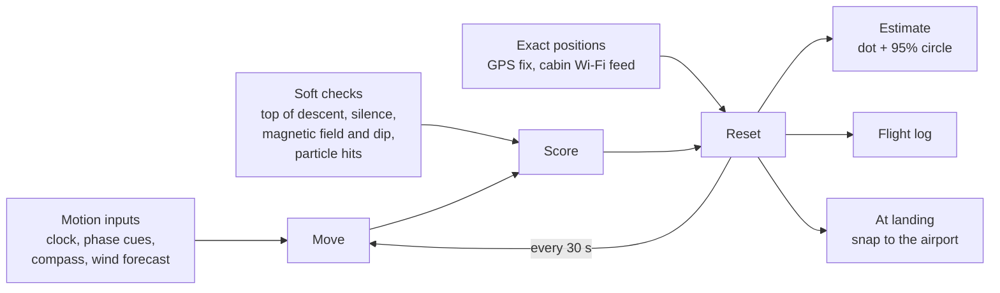
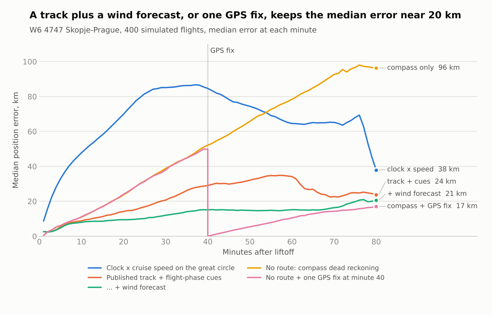

# Offline In-Flight Location Estimator: Draft App Spec

_Draft of 16 November 2026, copied from the project's spec document. What this repository implements, and where it differs, is listed at the end under [Implementation in this repository](#implementation-in-this-repository)._

This spec describes an Android app that estimates an aircraft's position from deep inside the cabin, with no satellite signal. It shows the estimate inside an error circle sized to be right 95% of the time.

In a simulation of flight W6 4747, a reference track and a wind forecast hold the median error near 15 km in cruise. With only a compass the error drifts to 96 km by landing, and a single GPS fix resets it. Every figure is a best case from simulation, so logging real flights is the first milestone.

## Scope and constraints

The app answers one question offline: roughly where is this aircraft now, and how sure is that estimate?

**In scope**

- A phone in airplane mode, deep in the cabin, with no usable satellite signal and no view of the sky.
- A position with an explicit error radius, refreshed about once a minute from takeoff to landing.
- The cabin Wi-Fi moving-map feed, when the aircraft offers one.
- A GPS fix whenever one happens to arrive: the estimate snaps to it and the error radius resets.
- Android first.

**Out of scope**

- Navigation or any safety use. The output is for curiosity and trip logging.
- Seeding the phone's satellite receiver. Stock Android gives apps no way to inject a position.
- Live flight data from the internet.

**Constraints**

- Sensors found on a typical phone only: accelerometer, gyroscope, magnetometer, barometer, camera and clock. The barometer is missing on some models, so the app must degrade without it.
- Everything else is preloaded before boarding.
- Battery use below 5% per flight hour.
- The phone will be picked up and moved. Inputs that need it still must detect handling and pause.

## Inputs

Nine inputs feed the estimate, and only the first two are needed for a useful answer.

| Input | What it yields | Typical uncertainty | Needs |
| --- | --- | --- | --- |
| Accelerometer + barometer | Times of takeoff, top of climb, top of descent and landing | Takeoff flagged about 1 min late, landing about 1.5 min late ([flyDetect](https://mdpi.com/1424-8220/24/18/6158)) | Barometer for the cabin-pressure cues |
| Clock + route | Progress along the planned track | Set by wind and routing; measured in the prototype below | Origin, destination, a reference track |
| Wind forecast | Expected cruise wind along the route | 15 km/h of error, against 60 km/h with no forecast (design values) | A download before boarding |
| Gyroscope | Turns: holds, diversions, final-approach direction | Heading drift of several degrees per hour (design value) | Orientation tracked while the phone is handled |
| Magnetometer as compass | Track direction | 5 to 10 degrees after gate calibration (design value) | Phone at rest, for example in the seat pocket |
| Magnetometer as field meter | Field strength and dip angle, compared with the [World Magnetic Model](https://ncei.noaa.gov/products/world-magnetic-model) | 0.7 µT and 1.5 degrees after gate calibration (design value) | Phone at rest; calibration before pushback |
| Camera as particle counter | Cosmic-ray hit rate: confirms cruise altitude, weak latitude cue | About 19 hits per hour at cruise on one tested phone ([Takano et al.](https://arxiv.org/pdf/2607.02106)) | Lens covered; phone on power |
| Cabin Wi-Fi feed | The aircraft's own latitude, longitude, speed and altitude ([inflight-wifi](https://github.com/southgate/inflight-wifi)) | Exact | An aircraft with a supported portal |
| GPS fix | True position, whenever one arrives | Metres | Luck, or a moment near a window |

Design values are assumptions used by the prototype. Field measurements replace them before any accuracy claim is published.

## Estimation engine

A particle filter carries 1,500 candidate positions, and every input either moves, scores or resets them.

Read left to right: each input group feeds one filter step, and the steps repeat every 30 seconds.

**One candidate holds** a position plus its own guesses for cruise wind, airspeed, climb time, descent distance and compass bias. On a known route the position is a distance along the reference track and an offset to its side. On an unknown route it is a latitude and longitude.

**Move.** Each candidate advances by the ground speed its own guesses imply: a climb ramp, cruise at airspeed plus wind, then a descent ramp. On an unknown route it advances along the measured heading.

**Score.**

- Top of climb and top of descent, read from cabin pressure, pin the speed profile. Top of descent also says the destination is about 225 km of track away on this aircraft type.
- Silence counts too. Candidates that should already be descending lose weight while the cabin pressure stays flat.
- Field strength and dip angle are compared with the magnetic model. A small Kalman filter inside each candidate tracks the sensor bias, so only the change since the gate matters.
- Particle hits are scored against the expected rate with a Poisson likelihood.

**Reset.** A GPS fix or a cabin-feed position first reweights the cloud, so candidates with the right wind and compass bias survive. Then every candidate moves onto the fix and the computation continues from there.

**Output.** The weighted mean position, and the radius around it that holds 95% of the weight.

## Operating modes

The app runs in the best mode the situation allows and always shows which one is active.

| Mode | When it applies | Position comes from | How the error behaves |
| --- | --- | --- | --- |
| Cabin feed | The aircraft's Wi-Fi portal exposes flight data | The aircraft's own navigation data, polled every 30 seconds | None to speak of |
| Known route | The user entered the flight, or origin and destination | Clock and phase cues along a reference track, with a wind forecast if one was preloaded | Bounded: set by wind and routing, and cut again at top of descent |
| Unknown route | Only the departure point is known | Compass heading and typical jet speed, starting from the departure airport | Grows with every minute flown |

A GPS fix is not a mode. In any mode it resets the estimate, and the computation continues from that point with better guesses for wind and compass bias.

W6 4747 has no cabin feed today, so the prototype covers the last two modes.

## Offline data package

Under 10 MB of preloaded data covers any flight, and only the reference track and the wind forecast are specific to one trip.

| Dataset | Used for | Size | Refresh |
| --- | --- | --- | --- |
| [World Magnetic Model 2025](https://ncei.noaa.gov/products/world-magnetic-model) coefficients | Expected field strength and dip at any position and altitude | One 93-line text file | New model every five years; this one expires 31 December 2029 |
| Airports and runways | Origin, destination, landing snap | About 1 MB for large and medium airports | Yearly |
| Reference track for the booked flight | Known-route mode | A few KB per flight | Fetched with the flight details before boarding; falls back to the great circle |
| Wind forecast along the route | Known-route mode: expected cruise wind | A few KB per flight | Fetched before boarding; good for that flight only |
| Aircraft performance table | Climb time, cruise speed and descent distance per aircraft type | Under 100 KB | With app updates |
| Cutoff-rigidity grid | Expected particle rate by position | Under 100 KB | With each magnetic model |
| Base map | Display | 3 to 5 MB at country level | With app updates |
| Portal adapters | Cabin feed endpoints per Wi-Fi vendor | A small config file | With app updates |

The magnetic model is free to use. A source and licence for reference tracks is an open question below.

## User experience

The user does three things: enters the flight, parks the phone, and glances at a map.

1. **Before boarding, online.** Enter the flight number, or pick origin and destination. The app downloads the reference track, the wind forecast and the airport data, then confirms it can run offline.
2. **At the gate.** A 20-second calibration records the magnetic field against the known airport position. The app asks the user to leave the phone where it will ride, such as the seat pocket.
3. **Takeoff.** Detected from the takeoff roll and the cabin-pressure drop. No tap is needed.
4. **Cabin Wi-Fi.** If a supported portal is found, the app asks once for permission to read its flight data and switches to the cabin feed.
5. **In flight.** A map shows the estimate as a dot inside an error circle sized to hold the true position 95% of the time. One line names the mode and inputs in use, for example "Known route: clock, phase cues, magnetometer".
6. **Phone picked up.** Magnetic and particle inputs pause and the circle widens. They resume after 60 seconds at rest.
7. **Particle counting, optional.** Offered only when the phone is on power. The user covers the camera lens; face down on the tray table is enough.
8. GPS signal, optional. Whenever GPS fix is detected, exact location is logged and the computation continues from that point.
9. **Landing.** Detected from cabin pressure. The estimate snaps to the airport, the flight log is saved, and satellite positioning takes over.

## Android implementation notes

One foreground service owns the sensors and the filter; the map screen only draws its output.

- **Service.** Android stops sensor delivery to background apps, so sampling runs in a foreground service with a visible notification. Since Android 14 each foreground service declares a type and holds the matching permission. The `location` type fits; the particle counter adds the `camera` type and `FOREGROUND_SERVICE_CAMERA` ([foreground service changes](https://developer.android.com/develop/background-work/services/fgs/changes)).
- **Sampling.** Accelerometer and gyroscope at 50 Hz, magnetometer at 10 Hz, barometer at 1 Hz. [flyDetect](https://mdpi.com/1424-8220/24/18/6158) found no gain above 20 Hz for takeoff detection and used 1 Hz pressure. Batch deliveries so the processor sleeps between them.
- **Magnetometer.** Read the uncalibrated sensor type, so the system's own recalibration cannot shift the bias mid-flight. Rotate the field vector with a gyroscope-plus-accelerometer attitude that ignores the compass, then take total strength and dip angle.
- **Magnetic model.** Android's [GeomagneticField](https://developer.android.com/reference/android/hardware/GeomagneticField) class is documented as using the 2020 model, valid until 2025. Bundle the 2025 coefficients so every phone computes the same reference.
- **Particle counter.** Long exposures at high gain with the lens covered, plus a hot-pixel mask learned in the first minute. On power only, because the camera runs continuously.
- **Cabin feed.** Recognise supported portals by host name and poll the flight-data endpoint the passenger moving map already uses, every 30 seconds. Never authenticate or bypass a paid tier, the rule the [inflight-wifi](https://github.com/southgate/inflight-wifi) tool also follows.
- **GPS**** fixes.** Keep a location request open for the whole flight. A fix is treated as an exact observation and every particle collapses onto it.
- **Filter cost.** 1,500 particles, updated every 30 seconds. The Python prototype processes a 90-minute flight in under a second, so battery use is set by the sensors and not by the maths.

## Prototype on flight W6 4747

With a preloaded track and a wind forecast, the simulated filter holds the median error near 15 km in cruise. With only a compass it drifts to 96 km by landing.

**The flight.** W6 4747 is Wizz Air's Skopje (SKP) to Prague (PRG) service, flown by an Airbus A321neo ([Trip.com](https://www.trip.com/flights/status-w64747/)). The great-circle distance is 1,067 km and the schedule allows 2 h 5 min. The latest flight, on 16 November 2026, left at 12:04 and arrived at 13:41, 34 minutes early ([Airportia](https://www.airportia.com/flights/w64747/skopje/prague/)). Eight recent flights spent 78 to 89 minutes between a tracker's takeoff and landing estimates ([PlaneMapper](https://www.planemapper.com/flights/W64747)).

**Setup**

- 400 simulated flights follow the published airway route via Belgrade ([Flight Plan Database](https://flightplandatabase.com/plan/149187), 1,086 km). Each adds random shortcuts, lateral wander and an arrival to one of Prague's four runway directions.
- Cruise wind along the track varies from flight to flight with a standard deviation of 60 km/h. Simulated time in the air has a median of 87 minutes.
- The phone's readings use the design values in the Inputs table.
- The magnetic reference barely changes on this route: 47.8 µT and 59.3 degrees of dip at Skopje, 49.6 µT and 66.3 degrees at Prague.
- The baseline is clock time multiplied by cruise speed along the great circle, the method the [GeekFlight](https://geekflight.pages.dev/tech.html) app documents for flying without GPS.
- Every estimator carries 1,500 candidates. The script is `inflight_sim.py`, run with seed 4747.

The error of the track-based estimate falls after minute 60 because the top-of-descent cue arrives. The fix at minute 40 also corrects the wind and compass-bias guesses, so the error regrows at about a third of its earlier rate. The clock-only line dips at minute 80 because that estimate has already parked at Prague.

**What else the runs show**

- **The error circle is honest.** The true position lay inside the 95% circle in 93 to 97% of flight-minutes, depending on the estimator.
- **A great circle is not a track.** The published route runs up to 72 km east of the great circle. With only the great circle as reference, the median error peaks at 74 km.
- **Phase cues pay off late.** In the last five minutes, the 90th-percentile error is 66 km without the top-of-descent cue and 33 km with it.
- **The magnetometer helps only without a route.** It trims the unknown-route median at minute 80 from 96 km to 85 km. On a known route it changes the result by about 1 km.
- **The particle counter adds nothing here.** About 49 hits per flight are too few to show a latitude effect.
- **Landing snap needs the runway.** Without a route, the final circle holds a median of 10 airports with scheduled service. Position alone picks Prague in 24% of flights. Adding the landing heading raises that to 80%, and a mid-flight fix raises it above 99%.

**Scaling to long flights (indicative).** The same filter ran on two synthetic long-haul legs, 80 flights each, with routes and winds invented for the test.

- **North-south, Frankfurt to Johannesburg, ten hours.** The dip angle swings from +66 to -62 degrees, and the magnetometer earns its place. On a known route it cuts the mid-flight median error from 171 km to 51 km. Without a route it cuts the error at landing from 788 km to 188 km.
- **East-west, Frankfurt to New York, seven hours.** The dip angle ends where it began, and the known-route gain shrinks to 150 km against 121 km. Without a route the magnetometer still cuts the landing error from 659 km to 267 km. A compass bias pushes an east-west track north or south, which is the direction the dip angle measures.
- **Particle counter.** Tested on the north-south leg at about 280 hits per flight, with no measurable effect.

**Limits.** The simulated flights are drawn from the same models the filter assumes, and the route is a ten-year-old plan. Treat every number here as a best case until real flights are logged.

## Accuracy targets and acceptance tests

Release needs eight results measured on real flights; the prototype only sets the bar.

| What is measured | Target for release | Test |
| --- | --- | --- |
| Takeoff and landing detection | 95% of flights, each flagged within 2 minutes | 30 flights logged at a window seat with GPS as truth |
| Known-route median error, flights of 1 to 3 hours | Under 40 km without a wind forecast, under 25 km with one | The same logs, replayed with GPS withheld |
| Unknown-route median error at landing | Under 10% of the distance flown | The same logs |
| Error-circle coverage | True position inside the 95% circle in at least 90% of flight-minutes | The same logs |
| Recovery after a GPS fix | Error under 5 km one minute later, and slower regrowth than before the fix | The same logs, with one fix released mid-flight |
| Landing snap without a route | Correct airport in at least 80% of flights | The same logs |
| Battery | Under 5% per flight hour with the particle counter off | Three phone models, screen off |
| Magnetometer bias stability | Drift under 0.5 µT and 1 degree per hour in a seat pocket | Bench and in-flight logs; decides whether the magnetic inputs ship |

## Risks, limitations and open questions

The largest risk is model mismatch: the prototype's simulated flights are drawn from the same models the filter assumes.

**Risks and limitations**

- **Model mismatch.** Real climb profiles, winds and routings will differ from the design values. Logging real flights against GPS truth is the first milestone.
- **Routing.** The reference track used for W6 4747 is a ten-year-old airway plan. If today's flights fly straighter, a stale track adds lateral error up to its distance from the real path.
- **Magnetometer.** A cabin is magnetically dirty and the phone gets moved. The bias design values are untested, and the magnetic inputs stay in the product only if field tests confirm them.
- **Particle counter.** One published phone test, with about 19 hits per hour at cruise at low latitude. That is too few counts to locate anything on a short flight.
- **Barometer.** Cabin pressure follows the aircraft only loosely, so the phase cues need tuning per aircraft type. Phones without a barometer lose them.
- **Cabin feed.** The endpoints are undocumented, cover a few portal vendors and can change without notice. Wizz Air plans to start installing Starlink in 2027 ([Onboard Hospitality](https://www.onboardhospitality.com/?p=60715)); until then W6 4747 is assumed to have no feed.
- **Not for navigation.** The app says so on first run.

**Open questions**

- [ ] Where do reference tracks come from, and under what licence?
- [ ] Which wind forecast source, and how small can the download be?
- [ ] Does Play review accept the `location` foreground service type for sensor-only positioning?
- [ ] How stable is the magnetometer bias in a seat pocket over a whole flight?
- [ ] Do airlines permit a third-party app to read the portal's flight data?
- [ ] Should raw sensor logs be uploaded, opt-in, to improve the model, and under what privacy terms?

## Sources

Pages opened on 16 November 2026.

- [Airportia, W6 4747](https://www.airportia.com/flights/w64747/skopje/prague/): route, distance, schedule and the 16 November times
- [PlaneMapper, W64747](https://www.planemapper.com/flights/W64747): takeoff and landing estimates for recent flights
- [Trip.com, W64747 status](https://www.trip.com/flights/status-w64747/): aircraft type
- [Flight Plan Database, plan 149187](https://flightplandatabase.com/plan/149187): the Skopje to Prague airway route and its waypoints
- [flyDetect, Sensors 2024](https://mdpi.com/1424-8220/24/18/6158): takeoff and landing detection from accelerometer and barometer
- [GeekFlight algorithms](https://geekflight.pages.dev/tech.html): the clock-and-cruise-speed method used as the baseline
- [inflight-wifi](https://github.com/southgate/inflight-wifi): flight data exposed by cabin Wi-Fi portals
- [Takano et al., arXiv 2607.02106](https://arxiv.org/pdf/2607.02106): cosmic-ray counts on a phone camera in flight
- [NOAA World Magnetic Model](https://ncei.noaa.gov/products/world-magnetic-model): model version, validity and coefficient file
- [Android foreground service changes](https://developer.android.com/develop/background-work/services/fgs/changes) and [GeomagneticField reference](https://developer.android.com/reference/android/hardware/GeomagneticField)
- [Onboard Hospitality](https://www.onboardhospitality.com/?p=60715): Wizz Air's Starlink plan
- [OurAirports data](https://github.com/davidmegginson/ourairports-data): airports and runways used in the landing-snap test

## Implementation in this repository

Added 17 November 2026. The sections above are the spec as drafted; this one records how the code in this repository implements it and where it differs.

- **Engine.** Everything that estimates is pure Kotlin in [`engine/`](../engine) (package `inflight.engine`, no Android imports): the World Magnetic Model 2025, the known-route and unknown-route particle filters, the flight-phase detector, heading alignment, an event-logged flight session with exact replay, the flight simulator and the self-tests. On 400 simulated W6 4747 flights it agrees with the Python prototype within test tolerance for every estimator ([results](../engine/results)). [ALGORITHM.md](ALGORITHM.md) describes it.
- **Modes.** "Known route" follows a preloaded track. With only origin and destination the app runs the same filter along the great circle and says "Great circle". "Unknown route" is compass dead reckoning. A GPS fix more than 60 km (or four lateral standard deviations) off the planned track switches to dead reckoning from that fix.
- **Phase cues.** The takeoff and landing rolls come from the accelerometer; the cabin climb, level-off, descent and touchdown from the barometer. On synthetic sensor streams for 200 simulated flights the cue times were within 10 seconds, and detector-made cues cost 0.3 km of median error against ideal ones on the same flights. Synthetic cabins are cleaner than real ones, so logging real flights stays the first milestone.
- **Heading.** The takeoff roll shows where the aircraft's nose points in phone coordinates, and the nearest runway direction of the origin airport corrects the compass. The fallback is manual: lay the phone flat, top edge toward the cockpit, and tap Align. Moving the phone ends the alignment.
- **Magnetometer.** As in the implementation notes: the uncalibrated sensor, with the system's bias estimate frozen at the gate, then the 20-second gate calibration against the magnetic model at the origin airport.
- **GPS.** A location request stays open for the whole flight. Each fix is logged, the estimate jumps to it, and the computation continues from it (user experience step 8).
- **Reference tracks.** Imported by the user from a KML, GPX or CSV file (for example the track of an earlier flight on the same route), plus the built-in W6 4747 route. The open question on track sources and licences stands.
- **Wind forecast.** Open-Meteo pressure-level winds at the planned cruise level, reduced to one mean tailwind for the route. This answers the second open question provisionally; Open-Meteo asks for attribution.
- **Flight log and acceptance tests.** Every observation is one line of a log file. The app rebuilds a flight exactly from its log after a restart, and the log plus a timed track of the real flight produces the error figures the acceptance tests ask for.
- **Not built yet.** Looking up a reference track from a flight number (no open source found), portal adapters for specific cabin Wi-Fi vendors (prompt 08 adds a configurable generic one), and a base map finer than Natural Earth 1:50m.
